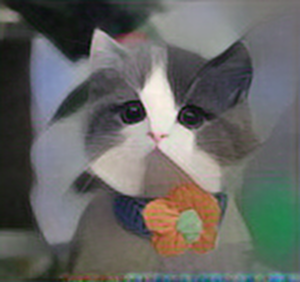

# RKNN Style Transfer

Real-time video and single-image neural style transfer on the Rockchip RK3576 NPU.
基于 Quectel Pi M2 智能主控板（RK3576）的实时视频 / 单张图片油画风格迁移示例。

```Plain
camera (MIPI) ──V4L2──▶ appsink ──▶ NPU 风格迁移 ──▶ appsrc ──▶ waylandsink
                       (取帧)      FastNeuralStyle      (回灌)      (显示)

image file ──────────────────────▶ NPU 风格迁移 ──────────────────▶ image file
```

系统通过 MIPI 摄像头（IMX219）实时采集画面，送入 RK3576 NPU 运行 FastNeuralStyle 油画风格迁移模型（udnie INT8），将画面实时转换为油画风格并输出到屏幕；同时也支持对单张图片进行转换。两条路径共用同一套 RKNN 推理封装（`librknn_style.so` + `rknn_style.py`）。

## 效果展示

| 原图 | udnie 油画风格 |
|-|-|
|  |  |

## 技术指标

| **项目** | **参数** |
|-|-|
| 采集分辨率 | 640×480 @ 30 fps（NV12） |
| 推理输入尺寸 | 160×160，3 通道 |
| 推理精度 | INT8（RK3576） |
| 风格模型 | udnie（FastNeuralStyle） |
| 实时帧率 | 约 2.7 FPS（RK3576 实测 2.64~2.76 FPS） |
| 单图转换耗时 | 594×559 图片约 350 ms（含读写约 0.4 s） |
| 显示方式 | Wayland（waylandsink），窗口或全屏 |
| 推理运行时 | librknnrt API 2.3.2 / NPU 驱动 0.9.8 |

## 运行前提

- RK3576 板子（本项目在 Quectel Pi M2 上验证），Debian 13
- MIPI 摄像头：camera0 = `/dev/video33`，camera1 = `/dev/video51`
- `/usr/lib/librknnrt.so`
- `python3` + `numpy` + `opencv` + GStreamer Python 绑定（`gi`/`Gst`）
- 桌面用户已登录 Wayland（`/run/user/<uid>/wayland-0`）

上述依赖在 Quectel Pi M2 出厂镜像中均已预装，可用如下命令校验：

```Bash
python3 -c "import cv2, numpy; print(cv2.__version__, numpy.__version__)"
python3 -c "import gi; gi.require_version('Gst', '1.0'); from gi.repository import Gst; print('gst ok')"
ls /usr/lib/librknnrt.so
```

## 目录结构

```Plain
.
├── run_on_board.sh             启动摄像头 demo
├── stop_on_board.sh            停止摄像头 demo
├── convert_image.sh            单图转换入口
├── build.sh                    重新编译 librknn_style.so（通常不需要执行）
├── src/rknn_style.c            build.sh 的源码
├── librknn_style.so            已编译好的推理包装库
├── rknn_style.py               RKNN ctypes 封装，两个主程序共用
├── oil_painting_cam.py         摄像头 demo 主程序
├── image_style.py              单图转换主程序
├── cat.png / cat_painting.png  单图转换示例（原图 / 效果图）
└── models/rknn/
    └── udnie-9_int8_rk3576.rknn
```

## 实时视频风格迁移

```Bash
./run_on_board.sh                  # 后台运行，640x480 窗口
./run_on_board.sh --fullscreen     # 全屏
./run_on_board.sh --fg             # 前台运行（Ctrl+C 退出）
./stop_on_board.sh                 # 停止
tail -f /tmp/demo_run.log          # 查看后台日志
```

参数：

| 参数 | 说明 |
|-|-|
| `-m/--model` | 风格，本分支仅 `udnie` |
| `--precision` | `int8`（本分支仅提供 INT8 模型） |
| `--camera` | 摄像头设备，默认 `/dev/video33` |
| `--frames N` | 跑 N 帧后退出，0 = 一直跑 |
| `--fullscreen/--windowed` | 显示模式，默认窗口 |
| `--fg/--bg` | 前台/后台，默认后台 |

首次成功启动时，日志中可看到模型与管线信息：

```Plain
[rknn] 模型 ./models/rknn/udnie-9_int8_rk3576.rknn
[rknn] api=2.3.2 driver=0.9.8
[rknn] 输入 160x160 C3
[info] 5 帧, 2.64 FPS
```

以 root 启动时，脚本会自动清理旧实例并切换到桌面用户 `q` 后运行，以访问 Wayland；也可用 `DEMO_USER` 指定桌面用户。

## 单张图片风格迁移

```Bash
./convert_image.sh cat.png                        # 输出 cat_udnie.png（同目录）
./convert_image.sh cat.png -o out/cat_paint.jpg   # 指定文件名，自动建目录
./convert_image.sh cat.png -o out/                # 指定目录，自动命名
./convert_image.sh cat.png -d out/paintings       # 同上，显式目录参数
./convert_image.sh a.png b.png -d out/            # 批量转换
./convert_image.sh cat.png -o 'out/{stem}_{model}.png'
```

输出命名规则：

| 写法 | 结果 |
|-|-|
| 不给 | `<输入目录>/<输入名>_<风格>.<原扩展名>` |
| `-o 路径/文件名.jpg` | 使用该文件名；无扩展名时沿用源扩展名 |
| `-o 目录/` 或以 `/` 结尾 | 目录内自动命名，目录不存在会自动创建 |
| `-o 已存在的目录` | 目录内自动命名 |
| `-d 目录` | 目录内自动命名 |
| `{stem}` / `{model}` | 在文件名中替换为输入名 / 风格名 |

其他参数：`-m/--model`、`--precision`、`--keep-size`（保留 160×160 模型输出、不做放大）、`--interp nearest|linear|cubic|lanczos`、`-q`。
`-o` 与 `-d` 不能同时使用；多输入时 `-o` 必须是目录。

## 重新编译（通常不需要）

`librknn_style.so` 已随仓库提供，直接运行即可。只有在更换板子或 glibc 不兼容时才需要重新编译。

### 板端原生编译

```Bash
apt-get install -y build-essential          # 提供 gcc
mkdir -p /usr/include/rknn                  # 放入 rknn_api.h
# 从 SDK 的 external/rknpu2/runtime/Linux/librknn_api/include/ 拷贝:
#   rknn_api.h -> /usr/include/rknn/rknn_api.h
./build.sh
```

`rknn_api.h` 是 Rockchip 的专有头文件，不纳入本仓库，需从
`RK3576_Linux6.1_BL01_*/external/rknpu2/runtime/Linux/librknn_api/include/` 获取。
脚本会按 `./include` → `/usr/include/rknn` → SDK 目录的顺序查找。

### 开发机交叉编译

```Bash
REPO=/path/to/RK3576_Linux6.1_BL01_v1.2.0 ./build.sh
```

脚本自动探测 `$REPO`（或环境变量）下的 aarch64 工具链与 `librknnrt.so`。`./build.sh -h` 查看全部选项与环境变量。

> 仓库里的 `librknn_style.so` 是为 RK3576 交叉编译的产物；在其他平台上请自行执行 `./build.sh` 重新编译。

## 常见问题

### 程序启动 15 秒后自动退出，提示未收到帧

```Plain
[错误] 15 秒未收到任何帧 —— 检查相机 /dev/video33 是否可用
```

- 用 `v4l2-ctl --list-devices` 确认摄像头已识别，camera0 应为 `/dev/video33`
- 检查 FPC 排线是否插紧、方向是否正确
- 若使用 camera1，需显式指定：`./run_on_board.sh --camera /dev/video51`

### 日志出现 libv4l2 pixformat 报错

```Plain
libv4l2: error getting pixformat: Invalid argument
```

这是 `v4l2src` 在 ISP 直出通路上的无害告警，脚本已设置 `GST_V4L2_FORCE_LIBV4L2=0` 规避。只要后续能正常出帧（日志出现 `[info] N 帧`）即可忽略。

### 启动报错 Wayland socket not found

```Plain
[error] Wayland socket not found: /run/user/1001/wayland-0; make sure q is logged in
```

- 确认桌面用户已登录图形界面，`waylandsink` 必须运行在 Wayland 会话中
- 若桌面用户不是 `q`：`DEMO_USER=your_user ./run_on_board.sh`

### 提示缺少 librknn_style.so 或找不到模型

```Plain
RuntimeError: 缺少 ./librknn_style.so, 请先在本目录执行 ./build.sh
找不到风格 'udnie' 的 int8 模型, 预期在 ./models/rknn
```

- 确认 `librknn_style.so` 与 `models/rknn/udnie-9_int8_rk3576.rknn` 均存在
- 推理库丢失时才需要重新编译，见上文「重新编译」

### 帧率偏低（约 2.7 FPS）

```Plain
[info] 10 帧, 2.76 FPS
```

这是当前 FastNeuralStyle 模型在 RK3576 NPU 上的正常水平（推理输入 160×160、INT8），并非异常。若需更高帧率，可减小推理输入分辨率、换用更轻量的风格模型，或降低显示分辨率。

### 推理初始化失败

```Plain
RuntimeError: rknn_init 失败: rknn_init 失败 ret=-1
```

- 确认 `/usr/lib/librknnrt.so` 存在，且与模型版本匹配（本模型面向 RK3576，运行时 API 2.3.2 / 驱动 0.9.8）
- 确认使用的是 `udnie-9_int8_rk3576.rknn`，其他平台转换的模型无法在本板运行

## 致谢

- FastNeuralStyle —— 风格迁移模型结构
- udnie 风格取自 Francis Picabia 的同名画作
- Rockchip RKNN Toolkit2 / RKNPU2 运行时

如在使用过程中遇到问题，欢迎在[移远官方论坛](https://forumschinese.quectel.com/c/quectel-pi/58)提交技术咨询。
